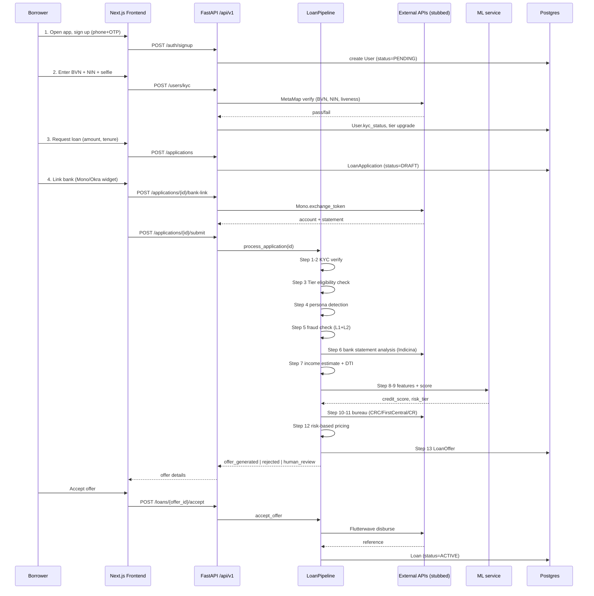
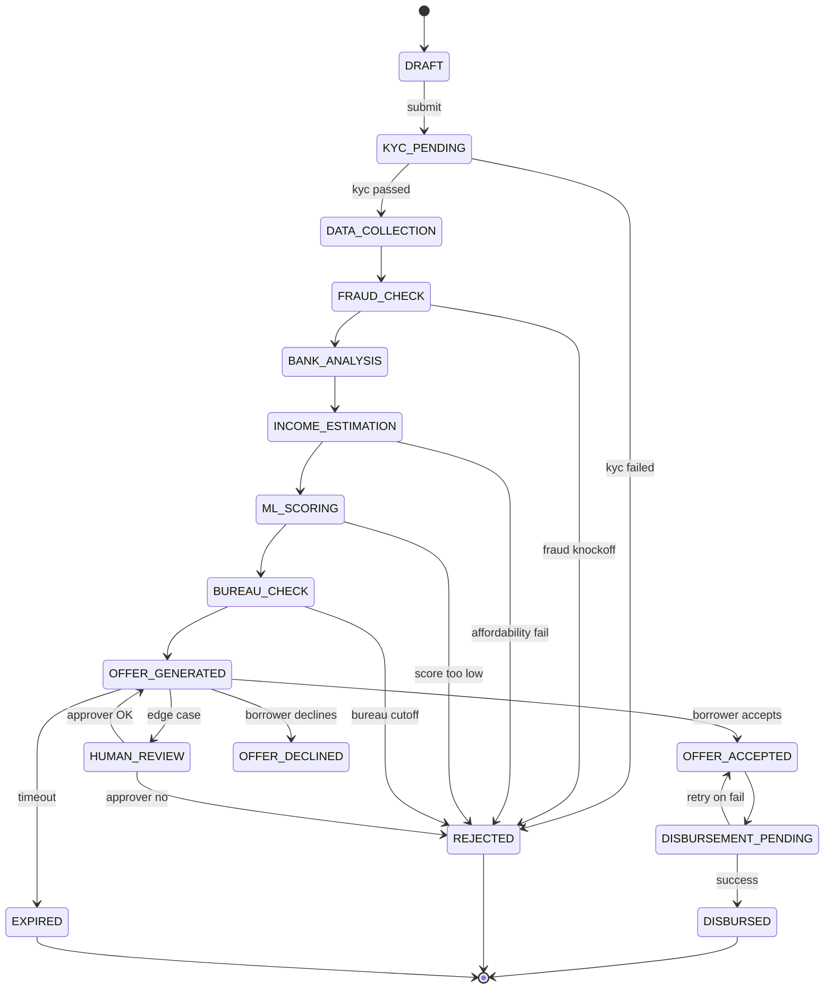
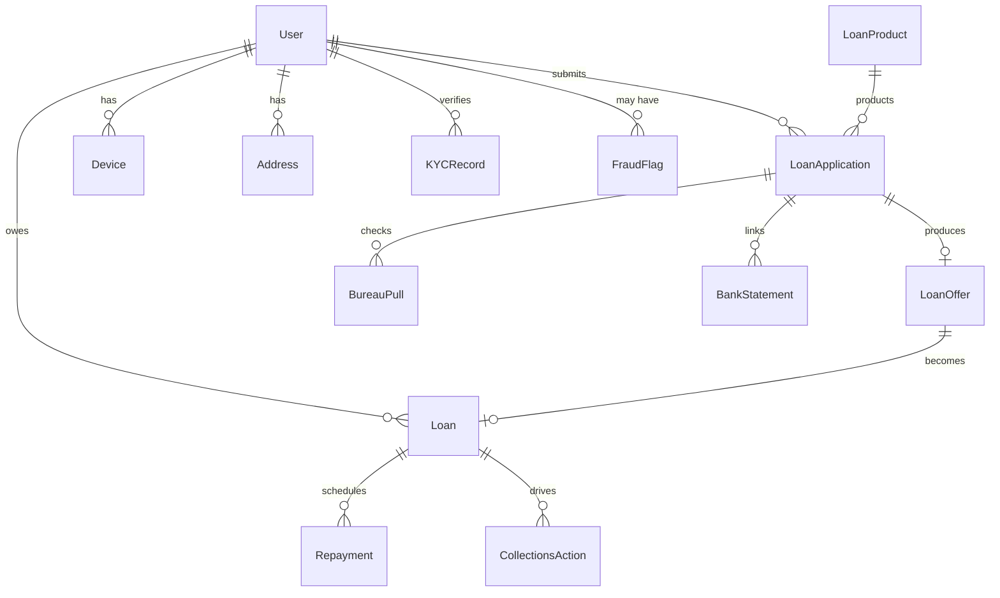

# Sharp Sharp Lending Platform — Architecture & Flow

**Owner:** Kayode Abel
**Last updated:** 2026-10-15
**Status:** Living document — reflects code as of audit, not aspirations.

This is the canonical reference for what the platform **is** and **is not**. Every section is annotated with reality status:

- **[BUILT]** — Code exists, logic is real (may use stubs for external calls).
- **[STUB]** — File/class exists but returns mock data or is partially wired.
- **[MISSING]** — Not in the codebase yet. Roadmap-only.

If you find a divergence between this doc and the code, **the code wins** — open a PR to fix the doc.

---

## 1. Purpose

A production-grade automated digital lending platform for Nigeria, an automated digital lending platform for Nigeria. Targets unsecured personal loans (₦5K-₦1M) with three loan types: bullet (single repayment), installment (multi-payment), and nano (small fallback). All borrowers go through a single underwriting path -- the loan ladder is the primary segmentation mechanism, not persona routing.

**Non-goals:** secured lending, BNPL, business lending, multi-country.

---

## 2. System architecture

```
┌─────────────────────────────────────────────────────────────────┐
│                         Borrower (mobile/web)                    │
│              Next.js 14 frontend (port 3000)                     │
└───────────────────────────────┬─────────────────────────────────┘
                                │ JSON/HTTPS
                                ▼
┌─────────────────────────────────────────────────────────────────┐
│              FastAPI backend  (port 8000)                        │
│   ┌──────────────────────────────────────────────────────┐      │
│   │  api/v1: auth, users, applications, loans, admin,    │      │
│   │          webhooks                                     │      │
│   └──────────────────────────────────────────────────────┘      │
│   ┌──────────────────────────────────────────────────────┐      │
│   │  services/loan_pipeline.py  ← THE BRAIN              │      │
│   │  Orchestrates KYC, fraud, bank, income, scoring,     │      │
│   │  bureau, pricing, offer, disbursement                │      │
│   └──────────────────────────────────────────────────────┘      │
│   ┌──────────────────────────────────────────────────────┐      │
│   │  workers/ (Celery + Redis)        [STUB — not wired] │      │
│   └──────────────────────────────────────────────────────┘      │
└──────┬─────────────────────────────────┬─────────────┬──────────┘
       │                                 │             │
       ▼                                 ▼             ▼
┌──────────────┐              ┌──────────────────┐  ┌─────────────┐
│ PostgreSQL15 │              │ ML service       │  │ External    │
│ + Alembic    │              │ FastAPI (8001)   │  │ integrations│
│              │              │ scoring_engine   │  │ (all STUB)  │
└──────────────┘              └──────────────────┘  └─────────────┘
```

**Components:**

| Component | Tech | Reality |
| --- | --- | --- |
| Backend API | FastAPI 3.11, SQLAlchemy 2.0 async | **[BUILT]** — 7 routers, 11 services, ~3.5K LOC |
| Database | PostgreSQL 15 | **[BUILT]** — models defined |
| Migrations | Alembic | **[STUB]** — only `env.py`, no migration files |
| ML service | FastAPI on port 8001 | **[STUB]** — scoring engine has logic but no trained model artifact |
| Frontend | Next.js 14 + Tailwind | **[STUB]** — 5 pages only (landing, login, signup, apply, dashboard, admin) |
| Celery workers | Celery + Redis | **[STUB]** — celery_app + tasks files exist, no jobs implemented |
| Cache / queue | Redis | **[BUILT]** — in docker-compose |
| Container | Docker + docker-compose | **[BUILT]** |
| K8s / Terraform | Helm, AWS | **[MISSING]** — empty folders |
| Tests | pytest | **[MISSING]** — empty `tests/` |

---

## 3. The 14-step loan flow

This is the canonical decisioning sequence orchestrated by `backend/app/services/loan_pipeline.py::LoanPipeline.process_application`.

### 3.1 Sequence diagram



### 3.2 Step-by-step

| # | Step | Service | Reality |
| --- | --- | --- | --- |
| 1 | **Application** — phone signup, basic PII | `api/v1/auth.py`, `users.py` | **[BUILT]** |
| 2 | **KYC Wall** — BVN + NIN + selfie liveness | `services/kyc_service.py` → `integrations/metamap.py` | **[STUB]** — service logic real, MetaMap call is mocked |
| 3 | **Tier Check** — loan ladder eligibility | `LoanPipeline._check_tier_eligibility` | **[BUILT]** — gates ₦200K cutoff between Tier 2/3 |
| 4 | **Data Collection** — employment, income, NOK | `api/v1/applications.py` | **[BUILT]** — model has fields; frontend missing the form |
| 5 | **Fraud Detection L1+L2** — composite score, knockoff | `services/fraud_service.py` | **[BUILT]** — logic real; graph DB layer not present |
| 6 | **Bank Statement** — Indicina/Mono/Okra aggregation | `services/bank_service.py` | **[BUILT]** — 581 LOC, deepest service |
| 7 | **Income Estimation** — ML income from bank patterns | `services/income_service.py` | **[BUILT]** — heuristic; ML income model missing |
| 8 | **Feature Engineering** — feature store | (inline in scoring_service) | **[STUB]** — no real feature store, no Redis-backed store |
| 9 | **ML Credit Scoring** — segment-specific model | `services/scoring_service.py` → `ml-service/scoring_engine.py` | **[BUILT]** — 5 LightGBM persona models trained on synthetic data (AUC 0.76–0.88, KS 0.39–0.60); artifacts in `ml-service/models/`. Re-train via `python scripts/train_baseline.py` |
| 10 | **Risk Tier Classification** — 17-tier mapping | inside scoring | **[STUB]** — buckets exist, calibration missing |
| 11 | **Credit Bureau** — CRC + FirstCentral + CreditRegistry | `services/bureau_service.py` | **[STUB]** — orchestration real, all 3 bureau clients return mocks |
| 12 | **Risk-Based Pricing** — rate = f(tier, income, ladder) | `services/pricing_service.py` | **[BUILT]** |
| 13 | **Loan Offer** — dynamic offer | `services/offer_service.py` | **[BUILT]** — generates schedule too |
| 14 | **Monitoring** — PSI/AUC/KS, DPD-tiered collections | `ml-service/monitoring.py`, `models/collections.py` | **[STUB]** — model exists, no collections engine, no SMS retry, no DPD bucketing job |

### 3.3 Disbursement (post-offer)

`LoanPipeline.accept_offer` handles offer → disbursement. Flutterwave integration is **[STUB]**. Loan record created with full repayment schedule.

---

## 4. Application state machine

`ApplicationStatus` enum (from `models/loan.py`):



`DeclineReason` enum captures: `fraud_knockoff`, `affordability_fail`, `bureau_cutoff`, `ml_score_low`, `income_insufficient`, `policy_violation`, `blacklisted`, `duplicate_application`.

---

## 5. Loan lifecycle (post-disbursement)

`LoanStatus` enum:

```
ACTIVE → CURRENT → DELINQUENT_7 → DELINQUENT_15 → DELINQUENT_30
       → DELINQUENT_60 → DELINQUENT_90 → DEFAULT (90+ DPD)
       → WRITTEN_OFF | RESTRUCTURED | PAID_OFF
```

DPD bucketing job: **[MISSING]** — no scheduled task moves loans through delinquency buckets. This is the single biggest collections gap.

---

## 6. Data model overview



Modules:
- `models/user.py` — User, Persona, Tier, KYCStatus, Device, Address
- `models/loan.py` — LoanProduct, LoanApplication, LoanOffer, Loan, Repayment, RepaymentSchedule
- `models/risk.py` — FraudFlag, BureauPull, MLScoreLog, FeatureSnapshot
- `models/collections.py` — CollectionsAction, DPDBucket, RestructureRequest
- `models/integration.py` — IntegrationLog, WebhookEvent

---

## 7. Underwriting approach

The platform uses a **single underwriting path** for all borrowers. There is no persona-based routing. Every applicant goes through the same 14-step pipeline.

The loan ladder is the primary segmentation mechanism:
- New users start at Tier 1 (small amounts, higher rates)
- Repeat borrowers who repay on time climb tiers (larger amounts, lower rates)
- The ladder encodes repayment behaviour, not employment type

**Note:** The codebase currently contains a `_detect_persona` function and persona-specific model artifacts. These are remnants of an earlier design that mixed in external patterns (persona routing) and external patterns (segment-specific scorecards). They should be removed or consolidated to match the single-path approach. The persona enum can remain for data collection but should not drive underwriting decisions.

---

## 8. Tier ladder

| Tier | Requirement | Max loan |
| --- | --- | --- |
| TIER_1 | phone + BVN | ≤ ₦200K |
| TIER_2 | + NIN + selfie liveness | ≤ ₦200K |
| TIER_3 | + proof of address | > ₦200K |

Enforced in `_check_tier_eligibility`. Tier upgrade flow on frontend: **[MISSING]**.

---

## 9. Integration map

All 11 integrations are **[STUB]** (mock responses). API contracts are sketched in code; nothing calls real endpoints.

| Integration | File | Used in step | Real call? |
| --- | --- | --- | --- |
| MetaMap | `integrations/metamap.py` | KYC (BVN/NIN/selfie) | No |
| Mono | `integrations/mono.py` | Bank link + statement | **Yes** — real v2 client (`/accounts/auth`, `/accounts/{id}`, `/accounts/{id}/statement`, `/accounts/{id}/unlink`); falls back to stub if `MONO_SECRET_KEY` unset |
| Indicina | `integrations/indicina.py` | Bank statement analysis | No |
| Okra | (referenced, not present as file) | Bank link | **[MISSING]** |
| CRC | `integrations/crc.py` | Bureau | No |
| FirstCentral | `integrations/first_central.py` | Bureau | No |
| CreditRegistry | `integrations/credit_registry.py` | Bureau | No |
| Flutterwave | `integrations/flutterwave.py` | Disbursement + repayment | No |
| Africa's Talking | (referenced, not present) | SMS/voice | **[MISSING]** |
| Terragon | (referenced, not present) | Telco data | **[MISSING]** |
| CredoLab | (referenced, not present) | Device intelligence | **[MISSING]** |

---

## 10. Frontend coverage

| Page | Path | Status |
| --- | --- | --- |
| Landing | `app/page.tsx` | **[BUILT]** basic |
| Sign up | `app/auth/signup/page.tsx` | **[BUILT]** |
| Login | `app/auth/login/page.tsx` | **[BUILT]** |
| Apply (loan request) | `app/apply/page.tsx` | **[BUILT]** |
| Dashboard | `app/dashboard/page.tsx` | **[BUILT]** |
| Admin | `app/admin/page.tsx` | **[BUILT]** basic |
| KYC steps (BVN/NIN/selfie) | `app/onboarding/kyc/page.tsx` | **[BUILT]** — selfie upload is stubbed liveness |
| Bank linking (Mono widget) | `app/onboarding/bank/page.tsx` | **[BUILT]** — loads `connect.withmono.com/connect.js`, calls `/users/bank/config` to fetch public key, real widget when keys configured else stub buttons |
| Application status tracker | `app/applications/[id]/page.tsx` | **[BUILT]** — polls pipeline, routes to offer when ready |
| Offer review & accept | `app/applications/[id]/offer/page.tsx` | **[BUILT]** |
| Loan detail + schedule | `app/loans/[id]/page.tsx` | **[BUILT]** |
| Repayment / pay now | `app/loans/[id]/repay/page.tsx` | **[STUB]** — Flutterwave checkout not wired |
| Profile / employment | `app/profile/page.tsx` | **[BUILT]** |
| Shared header + auth guard | `components/AppShell.tsx` | **[BUILT]** |
| OTP / phone verification | — | **[MISSING]** |
| Tier upgrade flow (NIN/address) | — | **[MISSING]** |

Borrower journey is now wired end-to-end: signup → KYC → apply → status → offer → accept → loan detail → repay.

---

## 11. Honest gaps — the build backlog

In rough priority order:

### Tier 1 (blocks demo end-to-end)
1. **Frontend KYC flow** (BVN/NIN/selfie) — currently no UI for steps 1-2.
2. **Bank linking widget** — Mono SDK integration on frontend.
3. **Offer acceptance + repayment screens** — without these, no borrower can actually take a loan.
4. **Trained ML model artifact** — `.pkl` for at least one persona, even on synthetic data.
5. **Alembic migrations** — `alembic revision --autogenerate` against models, commit migration files.

### Tier 2 (blocks production)
6. **Real integration credentials & sandbox calls** for at least Mono + Flutterwave.
7. **Celery worker tasks** — bureau pulls, SMS retries, async webhook processing.
8. **DPD bucketing job** — daily cron that transitions `LoanStatus` through delinquency.
9. **Collections engine** — SMS/voice templates per DPD bucket, escalation rules.
10. **Webhook handlers** for Flutterwave repayment, Mono account events.
11. **Feature store** — Redis-backed, real-time features for scoring.

### Tier 3 (productionization)
12. **Tests** — pytest suite, at minimum integration tests on `LoanPipeline`.
13. **K8s manifests + Terraform** — currently empty.
14. **Monitoring** — PSI/AUC/KS jobs, Grafana dashboards, alerting.
15. **Admin tools** — manual review queue, approval workflow, override audit log.
16. **Repayment reconciliation** — match Flutterwave settlements to repayment schedule.

---

## 12. Key design decisions (worth knowing)

- **Async SQLAlchemy 2.0** throughout — every service takes `AsyncSession`. No sync DB calls.
- **Pipeline is synchronous on a single transaction** — `process_application` runs all 14 steps in one async function under one DB session, committing only at offer generation. Trade-off: simple to reason about, but a slow bureau call blocks the whole pipeline. Production version should checkpoint state and resume async.
- **No persona routing** — Sharp Sharp does not segment by employment type. `_detect_persona` exists in the code but should not drive underwriting. The loan ladder is the segmentation mechanism. Persona-specific rate adjustments and per-persona models are external/external patterns that leaked in and should be removed.
- **Pricing fuses ML score + ladder tier + income** — see `pricing_service.calculate`. Risk-based, not flat. Ladder discount is the key differentiator for repeat borrowers.
- **Offer expiry is enforced** in `accept_offer` (returns `expired` status if past `expires_at`).
- **Disbursement failure rolls back to OFFER_ACCEPTED** so borrower can retry — does not re-trigger pipeline.

---

## 13. What this doc deliberately does not promise

To avoid the deck-honesty trap:
- **No live ML in production.** 5 LightGBM model artifacts exist (trained on synthetic data), but these are persona-specific models from a an earlier design iteration. The platform uses a single model. These need consolidation.
- **No real bureau, KYC, or bank integration.** Everything returns mock data (Mono has a real v2 client that falls back to stub).
- **No collections.** A loan that goes delinquent today will sit in `ACTIVE` forever until manually updated.
- **No mobile app.** "Mobile/web entry" refers to the Next.js web frontend only. Capacitor scaffolding exists but is not functional.
- **external/external patterns leaked in.** Persona routing, persona-specific models, persona rate adjustments, IPPIS detection, CredoLab, 4-layer fraud sub-scoring -- these are not how Sharp Sharp works. They need to be stripped to make this a true Sharp Sharp replica.

When showing this to anyone external, point them at this doc, not the README.

---

## 14. Next concrete step

Per the 2026-10-15 audit: **frontend and backend are now bootable and demo-ready**. All 15 frontend pages exist. Backend model-service mismatches have been fixed. Full Docker stack runs.

Next steps:
1. Strip external/external patterns from underwriting (persona routing, per-persona models, IPPIS detection, CredoLab, persona rate adjustments).
2. Consolidate 5 persona models into a single credit scoring model.
3. Remove `_detect_persona` from pipeline decision logic (keep for data collection only).
4. Simplify pricing to `base_rate + risk_premium - ladder_discount` (no persona_adjustment).
5. Seed demo data so end-to-end flow works out of the box.
6. Connect Mono + Flutterwave sandbox credentials.
