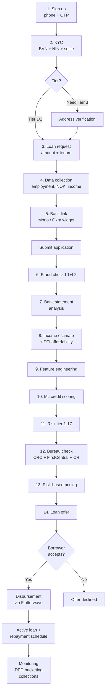
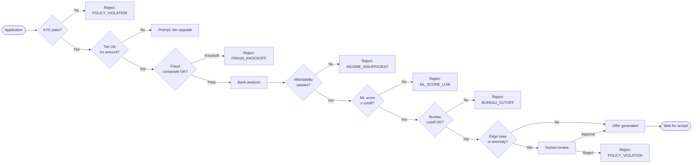
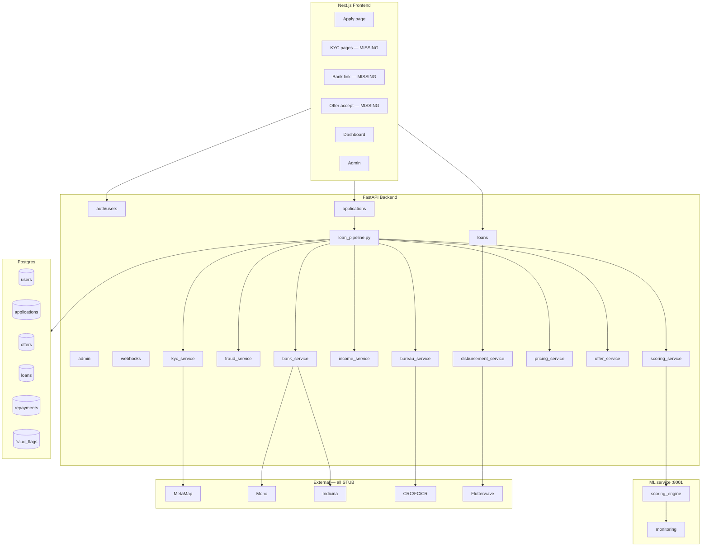
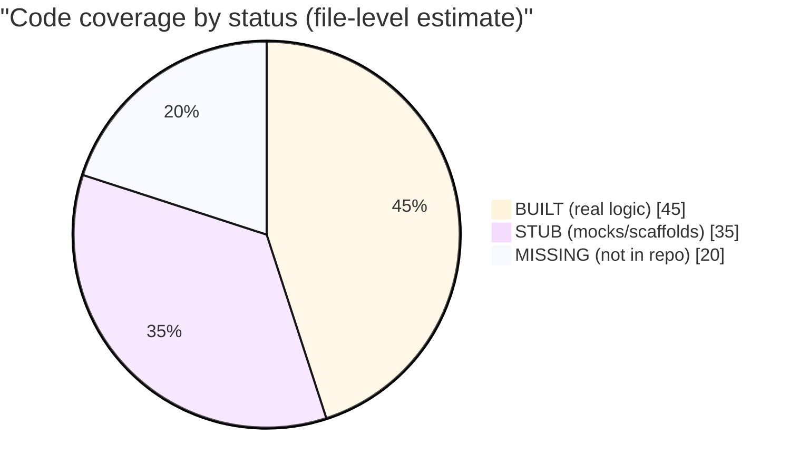

# Sharp Sharp Lending Platform — Flow Diagrams

Companion to `ARCHITECTURE.md`. Standalone diagrams for whiteboarding/decks.

---

## 1. End-to-end borrower journey (happy path)



---

## 2. Decision points & rejection paths



---

## 3. Loan lifecycle (after disbursement)

```mermaid
stateDiagram-v2
    [*] --> ACTIVE: disbursed
    ACTIVE --> CURRENT: 1st payment on time
    CURRENT --> CURRENT: payments on time
    CURRENT --> DELINQUENT_7: 1-7 DPD
    DELINQUENT_7 --> DELINQUENT_15: 8-15 DPD
    DELINQUENT_15 --> DELINQUENT_30: 16-30 DPD
    DELINQUENT_30 --> DELINQUENT_60: 31-60 DPD
    DELINQUENT_60 --> DELINQUENT_90: 61-90 DPD
    DELINQUENT_90 --> DEFAULT: 90+ DPD
    DEFAULT --> WRITTEN_OFF: 180+ DPD
    DEFAULT --> RESTRUCTURED: workout
    DELINQUENT_7 --> CURRENT: caught up
    DELINQUENT_15 --> CURRENT: caught up
    DELINQUENT_30 --> CURRENT: caught up
    CURRENT --> PAID_OFF: final payment
    PAID_OFF --> [*]
    WRITTEN_OFF --> [*]
```

---

## 4. Component & data ownership



---

## 5. Reality heatmap



Use this when discussing scope honestly — about half the platform is real, a third is scaffolded with mock returns, and a fifth is absent.
